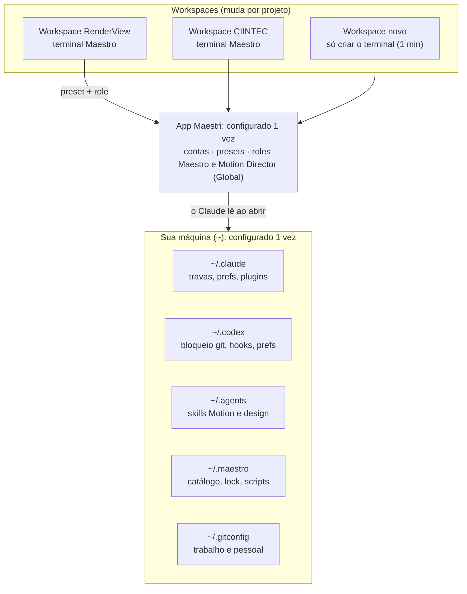

# Guia do Maestro: como funciona e como reinstalar

Atualizado em 21/10/2026 · Lucas Timponi Mercadante Castro

## Como funciona

O Maestro não é um programa instalado dentro do RenderView. Ele é um **Claude Code que abre lendo arquivos que ficam na sua máquina**, fora de qualquer projeto. Por isso, qualquer terminal aberto com o preset Maestro e o role Maestro, em qualquer workspace, já nasce sabendo as regras, as skills e os limites.



Só a camada de cima muda de projeto para projeto; as duas de baixo são as mesmas para todos os workspaces.

Há três camadas, de mais global para mais local:

1. **A máquina** (`~`, a sua pasta de usuário): skills, plugins, travas de git, preferências, catálogo e identidade git. Configurado **uma vez**; vale para tudo.
2. **O app Maestri**: contas, presets e roles. Configurado **uma vez**; como os roles são Global, valem para todos os workspaces.
3. **O workspace/projeto**: a pasta do repositório, o terminal do Maestro e as anotações da missão (`MISSION.md`). É a única parte que você cria a cada projeto novo, e leva menos de 1 minuto.

**O que acontece quando um terminal do Maestro abre**, em qualquer workspace:

1. O Maestri roda o comando do preset (`claude --dangerously-skip-permissions --model sonnet ...`).
2. O Maestri injeta as instruções do role Maestro (o "quem sou eu e quais são as regras").
3. O Claude Code lê `~/.claude/settings.json` (travas), `~/.claude/CLAUDE.md` (preferências) e lista as skills de `~/.claude` e `~/.agents/skills`.
4. Quando precisa escolher skills, o Maestro lê o catálogo em `~/.maestro/skills/`.
5. Quando recruta um agente (Codex Sol, Motion Director…), esse agente também lê os mesmos arquivos globais e o role dele.

O RenderView foi só a pasta onde o primeiro terminal estava aberto quando fizemos a instalação. Tudo o que foi instalado foi parar na camada 1, e não dentro dele.

## Onde fica cada configuração

Tudo fica na sua pasta de usuário (`/Users/lucas`, escrito `~`). As pastas que começam com ponto são ocultas; no Finder, **⌘ + Shift + .** as mostra.

| Camada | O quê | Onde fica | No kit |
| --- | --- | --- | --- |
| App Maestri | Contas, presets, roles (Maestro, Motion Director, Motion Helper, Motion Render e Design Director) | Dados do Maestri; backup em Configurações → Dados | `maestri/` |
| Máquina | Travas de git, skills só pelo nome, `maxEffortLevel`, `attribution`, hooks do RTK | `~/.claude/settings.json` | `claude/` |
| Máquina | Preferências gerais (PT-BR, Caveman, Ponytail, regra dos workers) | `~/.claude/CLAUDE.md` e `~/.codex/AGENTS.md` (cada um importa o `RTK.md` da própria pasta) | `claude/`, `codex/` (inclui os dois `RTK.md`) |
| Máquina | Plugins do Claude (Superpowers, Ponytail, Caveman, mattpocock, oficiais, cloud) | `~/.claude/plugins/` | lista em `PLUGINS.md` |
| Máquina | Skills de Motion e design (Claude e Codex) | `~/.agents/skills/` | lista em `PLUGINS.md` |
| Máquina | Bloqueio de git nos workers Codex | `~/.codex/rules/default.rules` | `codex/` |
| Máquina | Hook do RTK no Codex (os hooks do Ponytail e do Superpowers vêm dos plugins) | `~/.codex/hooks.json` | `codex/` |
| Máquina | RTK (exclusões de `maestri`, `git diff`, `git log`, `git status`) | `~/Library/Application Support/rtk/config.toml` e `filters.toml` | `rtk/` |
| Máquina | Catálogo de skills, regra dos plugins de cloud, versões fixadas, scripts | `~/.maestro/` (`skills/CATALOG.md`, `skills/catalog/`, `profiles.md`, `vendor/TOOLKIT.lock`, `scripts/`) | `maestro/` |
| Máquina | Times, gates e playbooks lidos pelos roles | `~/.maestro/maestri/` (`teams.md`, `quality-gates.md`, `design-playbook.md`, `motion-playbook.md`, `execution-playbooks.md`) | `maestri/` |
| Máquina | Backups da instalação | `~/.maestro/backups/` | não vai |
| Máquina | Identidade git (trabalho e pessoal) | `~/.gitconfig`, `~/.gitconfig-work`, `~/.gitconfig-personal` | `git/` |
| Máquina | Caveman e Graphify | `~/.config/caveman/config.json`; `GRAPHIFY_NO_AUTO_REFRESH` em `~/.zshrc` | `config/`, `shell/` |
| Máquina | Metodologia (cópia fixada) | `~/Documents/GitHub/vibe-coding-toolkit` | SHA em `maestro/vendor/TOOLKIT.lock` |
| Projeto | Cópia do role e anotações da missão | `<projeto>/.maestri/` | não vai |

Credenciais (logins do Claude e do Codex, `auth.json`) também ficam em `~/.claude` e `~/.codex`, mas **nunca** vão para este repositório: na máquina nova você faz login de novo.

## Manter este kit atualizado

O repositório guarda as **configurações e textos**; as skills e os plugins em si são baixados de novo na máquina nova, nas mesmas versões, a partir de `PLUGINS.md` e `maestro/vendor/TOOLKIT.lock`. Sempre que mudar alguma configuração, peça ao Maestro:

```markdown
Atualize o ~/Documents/GitHub/maestro-kit com as configurações atuais (mesma lista de arquivos do kit),
regenere PLUGINS.md, rode a busca por segredos, mostre o diff e peça aprovação do commit e do push.
Nunca inclua auth.json, tokens, chaves, cookies, histórico de sessões nem hashes de confiança de hooks.
```

## Instalação em outra máquina: passo a passo

São duas partes: o que **você** faz à mão (esta seção, ~20 min) e o que o **Maestro** faz sozinho com o prompt da próxima seção, pedindo seu "ok" a cada etapa.

### 1. Programas

- [ ] Maestri (Mac: Apple Silicon, macOS 15.4+; Windows 11 x64)
- [ ] Git e GitHub Desktop
- [ ] Homebrew (Mac)
- [ ] Claude Code **2.1.293 ou superior** (`claude --version`)
- [ ] Codex CLI **0.161 ou superior** (`codex --version`)
- [ ] Node.js LTS (para `npx skills`)

### 2. Repositórios

- [ ] No GitHub Desktop, clone `luctmc/maestro-kit` (privado) e `luctmc/vibe-coding-toolkit` para `~/Documents/GitHub/`.

### 3. Maestri → Configurações (⌘ + ,)

- [ ] **Geral → Sistema:** marque "Solicitar confirmação ao encerrar".
- [ ] **Agentes → Contas:** faça login no **Claude Code**; no **Codex**, login na conta 1 (fica "Padrão") e "+ Adicionar conta" com a conta 2 (nome **Codex 2**).
- [ ] **Agentes → Uso:** ative os anéis de uso.

### 4. Presets (Terminal → Início Rápido)

Crie estes 10 com "+ Adicionar preset". Depois **desmarque** os presets padrão "Claude Code" e "Codex" e mantenha "Shell". A lista também está em `maestri/presets.md`.

| Nome | Comando | Conta | Maestro |
| --- | --- | --- | --- |
| Maestro | `claude --dangerously-skip-permissions --model sonnet --effort medium` | — | ☑ |
| Claude Sonnet | `claude --dangerously-skip-permissions --model sonnet --effort medium` | — | ☐ |
| Codex Sol 1 | `codex --yolo -m gpt-6.1-sol -c model_reasoning_effort=medium` | Padrão | ☐ |
| Codex Sol 2 | `codex --yolo -m gpt-6.1-sol -c model_reasoning_effort=medium` | Codex 2 | ☐ |
| Codex Luna 1 | `codex --yolo -m gpt-6-luna -c model_reasoning_effort=low` | Padrão | ☐ |
| Codex Luna 2 | `codex --yolo -m gpt-6-luna -c model_reasoning_effort=low` | Codex 2 | ☐ |
| Motion Director | `claude --dangerously-skip-permissions --model claude-opus-5-5 --effort high` | — | ☑ |
| Design Director | `claude --dangerously-skip-permissions --model claude-opus-5-5 --effort high` | — | ☑ |
| Motion Helper | `claude --dangerously-skip-permissions --model claude-opus-5-5 --effort high` | — | ☐ |
| Motion Render | `claude --dangerously-skip-permissions --model claude-opus-5-5 --effort medium` | — | ☐ |

O checkbox Maestro marcado no Motion Director e no Design Director é proposital: é o que permite a eles recrutar auxiliares. Motion Helper e Motion Render ficam sem Maestro e não recrutam. Todo motion roda só em Opus 5.5; o Motion Render (medium) executa apenas renders e capturas mecânicas com comandos escritos por um Opus high.

### 5. Roles (Agentes → Responsabilidades)

- [ ] "+ Nova responsabilidade" → **Maestro**, espaço de trabalho **Global**, instruções de `maestri/roles/maestro.md` (ou da seção "Textos dos roles").
- [ ] "+ Nova responsabilidade" → **Motion Director**, **Global**, instruções de `maestri/roles/motion-director.md`.
- [ ] "+ Nova responsabilidade" → **Design Director**, **Global**, instruções de `maestri/roles/design-director.md`.
- [ ] "+ Nova responsabilidade" → **Motion Helper**, **Global**, instruções de `maestri/roles/motion-helper.md`; e **Motion Render**, **Global**, `maestri/roles/motion-render.md`.
- [ ] O `restore.sh` copia `maestri/` para `~/.maestro/maestri/`: é de lá que os roles leem `teams.md` (catálogo de 15 times), `quality-gates.md`, `design-playbook.md`, `motion-playbook.md` e `execution-playbooks.md` (playbooks de execução e guarda de quota, adaptados do Alethe). `routing-matrix.md` é só referência.

### 6. Primeiro terminal do Maestro

- [ ] Crie um workspace (qualquer projeto).
- [ ] Ferramenta Terminal → preset **Maestro** → aba **Agente**: role **Maestro** → diretório do projeto → **Criar**.
- [ ] Confira no terminal: modelo **Sonnet 5.5**, effort **medium** e **bypass permissions on** no rodapé.
- [ ] Cole o prompt da próxima seção.

## Prompt de instalação para o Maestro

Use o **caminho A** (este kit). O **caminho B** só se o kit não existir. Os dois já incluem as correções feitas na primeira instalação (catálogo dividido, skills só pelo nome, RTK sem cortar o git, identidade pelo remoto, bloqueio de git no Codex, sem trailer de coautoria).

### Caminho A: restaurar deste kit

```markdown
@Maestro Setup mission (L2): restore my agent environment from ~/Documents/GitHub/maestro-kit.
Rules: one step at a time; before each step show exactly what will change and wait for my "ok". Report in Portuguese, 2-3 lines per step.
1. Read README.md, PLUGINS.md and maestro/vendor/TOOLKIT.lock from the kit.
2. Run scripts/restore.sh (it backs up what exists, then copies settings, CLAUDE.md, AGENTS.md, both RTK.md, Codex rules/hooks, RTK config, gitconfig files, caveman config, ~/.maestro). Show me the list of overwritten files first. On Windows/Linux, adapt the paths first.
3. Reinstall every tool, plugin and skill listed in PLUGINS.md at the recorded versions/SHAs, keeping each one enabled/disabled exactly as listed.
4. Re-apply: skillOverrides "name-only" for motion/design skills (Claude) and allow_implicit_invocation: false (Codex) as listed.
5. Verify (see section "Verificação final") and tell me which terminals must be restarted.
```

### Caminho B: instalar do zero

```markdown
@Maestro Setup mission (L2). Install and configure my agent environment step by step.
Rules: one step at a time; before each step show exactly what will change and wait for my "ok". Pin versions/commits and record them in ~/.maestro/vendor/TOOLKIT.lock. Report in Portuguese, 2-3 lines per step.

Step 0 - Safety and identity
- Back up only configuration (not session history) of ~/.claude, ~/.codex and ~/.gitconfig into ~/.maestro/backups/<date>/.
- Merge into ~/.claude/settings.json: permissions.ask = Bash(git commit *), Bash(git push *), Bash(git merge *), Bash(git rebase *), Bash(git reset --hard *), Bash(git branch -D *), Bash(maestri floor land *), Bash(maestri floor delete *), Bash(rm *); permissions.deny = Bash(git push --force*); maxEffortLevel "high"; attribution { commit: "", pr: "", sessionUrl: false }.
- Git: user.name "Lucas Timponi Mercadante Castro", user.useConfigOnly true, identity by remote with includeIf "hasconfig:remote.*.url:...": Azure DevOps (dev.azure.com, *.visualstudio.com) -> lucas.castro@montreal.com.br; github.com/luctmc -> luctmc@outlook.com. AFTER those rules (last one wins), add includeIf "gitdir:~/Documents/GitHub/CIINTEC*/" -> lucas.castro@montreal.com.br, because the CIINTEC* folders are work even when their remote is on the personal GitHub.
- ~/.codex/rules/default.rules: prefix_rule decision="forbidden" for git commit, push, merge, rebase, reset, branch -D.

Step 1 - Methodology (vibe-coding-toolkit, local pinned copy at ~/Documents/GitHub/vibe-coding-toolkit)
- Agent tooling only, for Claude Code and Codex: Superpowers (obra/superpowers), Ponytail (full), Caveman (default mode "caveman", no proxy/cloud), RTK, Graphify (GRAPHIFY_NO_AUTO_REFRESH=1, no graphify install), Context7 (anonymous), agent-browser, pnpm, fd. Skip fnm, Docker and OS changes.
- RTK: exclude maestri, git diff, git log and git status from rewriting ([hooks] exclude_commands); test before enabling the hook.
- Write ~/.claude/CLAUDE.md and ~/.codex/AGENTS.md (same text, ~20 lines): replies in Brazilian Portuguese, short; Caveman for chat only; Ponytail full; commit messages in PT-BR Conventional Commits; never run git write commands unless you are the Maestro and the user approved; recruited workers are pre-authorized by the Maestro's brief, skip Superpowers approval gates, report in max 10 lines with DONE | DONE_WITH_CONCERNS | NEEDS_CONTEXT | BLOCKED. Show me the text first.

Step 2 - Engineering plugins
- Enabled globally: mattpocock-skills, code-review, skill-creator, LSPs for my stacks (typescript, csharp, python).
- Installed but disabled by default (enable per mission and tell me in 1 line; rule in ~/.maestro/profiles.md): dotnet/skills, microsoft/azure-skills (AZURE_MCP_COLLECT_TELEMETRY=false), google/skills, czlonkowski/n8n-skills (SessionStart hook off).

Step 3 - Motion and design skills (npx skills add, global, Claude and Codex)
- emilkowalski/skills, remotion-dev/skills, vibe-motion/skills, iart-ai packs (motion-design, web-animation, kinetic-typography, explainer-video, data-animation, ad-video, tiktok-video; lower-thirds only the copy inside tiktok), anthropics/skills (frontend-design, canvas-design).
- Claude: skillOverrides "name-only" for all of them. Codex: allow_implicit_invocation: false (agents/openai.yaml) for all of them. Do not touch maestri* skills.

Step 4 - Catalog
- ~/.maestro/skills/CATALOG.md = index only (choice rules + category list, max ~60 lines).
- One file per category in ~/.maestro/skills/catalog/: methodology, engineering, cloud, motion, design-ui, images. One line per skill: name | source | when to use | when NOT | conflict. English. Remotion = personal projects only.
- Keep the generator at ~/.maestro/scripts/build_catalog.py.

Step 5 - Verify (see section "Verificação final").
```

## Textos dos roles

Os textos completos e atuais estão em `maestri/roles/maestro.md`, `maestri/roles/motion-director.md` e `maestri/roles/design-director.md`. Cole cada um inteiro no campo **Instruções** do role correspondente (Agentes → Responsabilidades), com espaço de trabalho **Global**. Se você mudar algum role no Maestri, atualize também esses arquivos.

## Atualização Times e Quality-first (28/10/2026)

O Maestro agora escolhe o time pelo **tipo de tarefa** (`maestri/teams.md`, 15 times), escreve o brief em arquivo (nota 0–10, mínimo 7) e aceita só com evidência (`maestri/quality-gates.md`). Só o Design Director e o Motion Director recrutam auxiliares (profundidade 2).

- **Design Director** (Opus 5.5 high): analisa o pedido e monta o time por sub-tarefa, podendo usar Claude, Codex, imagem ou Figma e trocar o time no meio da missão. Procedimento em `maestri/design-playbook.md`; doutrina na skill própria `skills/design-excellence/` (ainda não instalada: precisa de aprovação).
- **Motion Director** (Opus 5.5 high): todo motion, sem exceção, só em Opus 5.5. Helpers: Motion Helper (high) e Motion Render (medium, só render mecânico). Tokens de motion, receitas, rubrica e QA por frames em `maestri/motion-playbook.md`.
- Scouts somente leitura em Haiku (conferir o ID no CLI) ou subagente nativo; revisor novo do mesmo vendor por padrão, outro vendor só em auth, pagamento, dados pessoais e L3.

Atualize roles e presets globais no aplicativo; os arquivos do GitHub não reconfiguram a instalação do Maestri sozinhos.

## Verificação final

Depois da instalação, rode estes testes. São os mesmos que validaram a primeira máquina.

**1. Teste de roteamento** (cole no Maestro; ele não executa nada):

```markdown
@Maestro Teste de configuração, sem executar nada e sem recrutar ninguém.
Para cada pedido, diga em 2-3 linhas: nível (L0-L3), presets/contas, skills do catálogo e se pediria aprovação:
a) "Corrija um texto errado no botão de login"
b) "Crie uma tela de dashboard com gráficos e filtros"
c) "Faça um vídeo institucional de 30s para o CIINTEC"
d) "Gere uma imagem de capa para o site do Orbit"
e) "Crie uma landing page de premiação, com tipografia editorial e scroll cinematográfico"
```

| Pedido | Resposta esperada |
| --- | --- |
| a | L0, ele mesmo faz, **pergunta a branch base** (nunca presume `main`) |
| b | Se for dashboard funcional: Sonnet + revisão técnica; se for interface premium: Design Director Opus 5.5 aprova direção e render, implementação delimitada + QA visual |
| c | Motion Director (Opus 5.5) faz storyboard, TODO código de Motion, render e QA; nunca transfere animação a Codex/Sonnet; sem Remotion (trabalho) |
| d | `$imagegen`; logo em SVG |
| e | Design Director (Opus 5.5) + Motion Director (Opus 5.5) para toda animação; validar mobile, tablet, desktop e redução de movimento |

**2. Hooks do Codex:** recrute um Codex Sol 1 e um Codex Sol 2, digite `/hooks` em cada um, **clique dentro do terminal** (não na barra "Mensagem para…") e aperte `t`. A coluna *Active* deve ficar em 1. Depois `esc` até voltar ao prompt.

**3. Trava de git no Codex** (cole no Maestro):

```markdown
Crie /tmp/teste-git com git init e user.email teste@local só nesse repo. Recrute "Codex Luna 1" (nome Teste-Git) apontado para essa pasta
e peça `git commit --allow-empty -m teste`. Reporte se a regra bloqueou em YOLO, dispense o Teste-Git e apague /tmp/teste-git.
```

Esperado: `Rejected ... Git write commands are reserved to the Maestro`.

**4. Trava de git no Claude:** quando o Maestro tentar um `rm`, `git commit` ou `git push`, deve aparecer "Permission rule … requires confirmation" mesmo com *bypass permissions on*. Responda **1. Yes** para permitir só aquela vez; nunca a opção 2, que libera para sempre.

**5. Identidade git:** peça ao Maestro `git config user.email` em um repositório de trabalho do Azure, no repositório `CIINTEC` (remoto no GitHub pessoal, deve dar o e-mail de trabalho) e em um pessoal. Num commit de teste, confira que não aparece `Co-Authored-By`.

## Uso no dia a dia

**Projeto novo** (clonado pelo GitHub Desktop ou criado do zero):

1. No Maestri, crie o workspace apontando para a pasta do repositório.
2. Crie o terminal com o preset **Maestro** e o role **Maestro**.
3. Pronto: ele já tem as skills, o catálogo, as regras de git e as travas. Nada de reinstalar.
4. O que ele ainda não conhece é o projeto em si (stack, comandos); isso ele lê no repositório na primeira missão.

**Identidade git em projeto novo:** com o mapeamento pelo remoto, repositórios do Azure DevOps usam `lucas.castro@montreal.com.br` e os do `github.com/luctmc` usam `luctmc@outlook.com`, automaticamente. Exceção: qualquer pasta `~/Documents/GitHub/CIINTEC*/` é trabalho e usa `lucas.castro@montreal.com.br` mesmo com remoto no GitHub pessoal; essa regra vem **depois** das de remoto no `~/.gitconfig`, para a pasta prevalecer. Projeto de trabalho novo com remoto no GitHub pessoal precisa ficar numa pasta `CIINTEC*` (ou ganhar uma regra `gitdir` própria). Um repositório sem remoto (recém-criado com `git init`) não consegue commitar até ter remoto; o Maestro avisa e pergunta.

**Ciclo de uma missão:**

1. Você pede em português, do jeito que quiser.
2. Ele classifica, pergunta só o necessário (inclusive a branch base) e delega.
3. Ele mostra diff, testes, e-mail de autor e mensagem de commit em PT-BR, e espera o seu "ok".
4. Ao terminar: peça "encerre a missão" e depois digite `/clear` no terminal do Maestro.

**O que o `/clear` apaga:** só a conversa. As regras, skills e travas continuam, porque estão nos arquivos da máquina e no role.

**Telas de aprovação em agentes recrutados:** se um worker parar numa tela (hooks, confirmação), clique dentro do terminal dele e resolva lá. Responder ao Maestro não aprova nada no outro terminal.

## Diferenças no Windows

O procedimento é o mesmo; mudam caminhos e alguns comandos. O Maestro do Windows deve adaptar o `restore.sh` (ou criar um equivalente em PowerShell) antes de rodar.

| Item | macOS | Windows |
| --- | --- | --- |
| Maestri | 0.54.x | Numeração própria (0.25.x); confira no changelog do Windows se Maestro Mode, Contas e Uso estão disponíveis |
| Pasta de usuário | `~` = `/Users/lucas` | `%USERPROFILE%` = `C:\Users\<você>` |
| Instalar Claude Code | `curl` ou Homebrew | `irm https://claude.ai/install.ps1 \| iex` ou `winget install Anthropic.ClaudeCode` |
| Instalar Codex | `curl` ou Homebrew | `irm https://chatgpt.com/codex/install.ps1 \| iex` |
| Ferramentas (RTK, uv, fd, pnpm) | Homebrew | winget ou scoop; o Maestro verifica a fonte de cada uma |
| Config do RTK | `~/Library/Application Support/rtk/` | Caminho diferente; o Maestro verifica antes de copiar |
| Skills via `npx skills` | Links normais | Use `--copy` para evitar problemas com links |
| `includeIf` do git | Igual | Igual para as regras por remoto (`hasconfig`); na regra de pasta `CIINTEC*` use `gitdir/i:C:/Users/<você>/Documents/GitHub/CIINTEC*/` |
| Fim de linha | — | `git config --global core.autocrlf true` |
| Graphify | `GRAPHIFY_NO_AUTO_REFRESH` no `~/.zshrc` | `setx GRAPHIFY_NO_AUTO_REFRESH 1` |
| Floors | Worktree ou cópia rápida | Só worktree |

Se usar o Maestri com runtime WSL, a parte dentro do WSL segue a coluna macOS/Linux e precisa da própria instalação.
